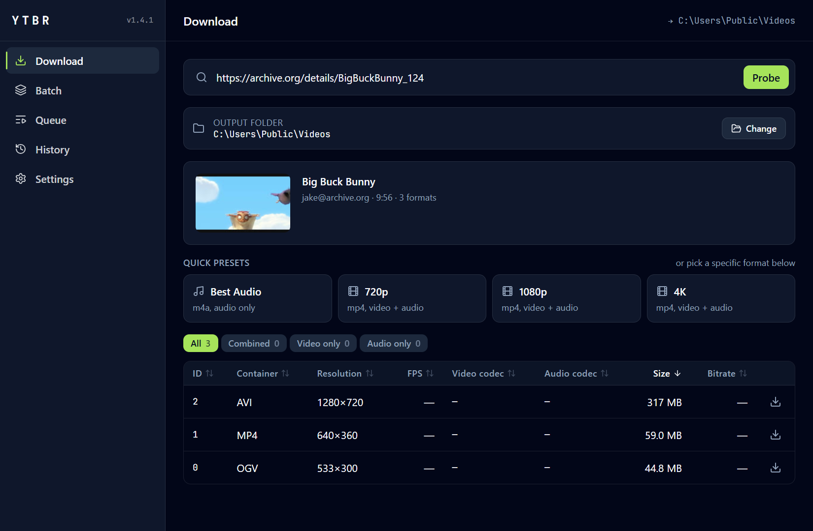
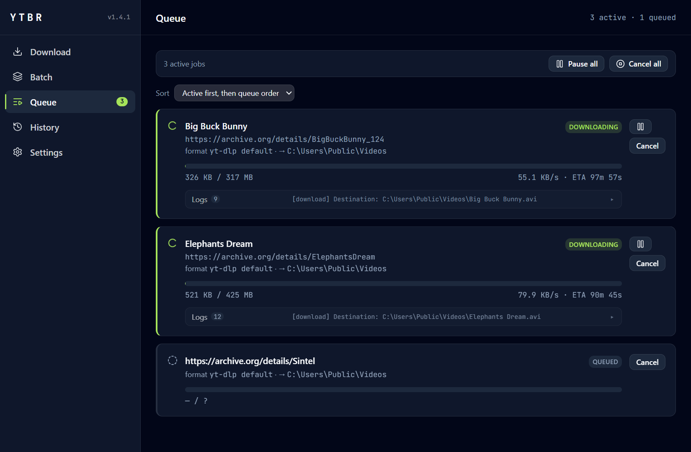
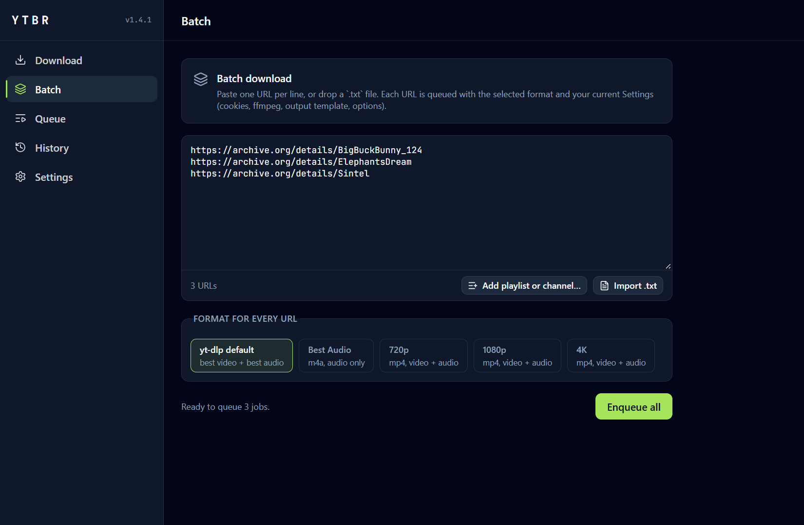

<h1 align="center">YTBR</h1>

<p align="center">
  <strong>A fast, lightweight yt-dlp GUI for Windows and Linux.</strong><br>
  Paste a link, pick a format, download — video or audio, one URL or a whole playlist.
</p>

<p align="center">
  <a href="https://github.com/lkasdorf/ytbr/releases/latest"></a>
  <a href="https://github.com/lkasdorf/ytbr/releases"></a>
  <a href="https://github.com/lkasdorf/ytbr/actions/workflows/ci.yml"></a>
  <a href="LICENSE"></a>
</p>

<p align="center">
  <a href="https://github.com/lkasdorf/ytbr/releases/latest"><strong>Download for Windows or Linux</strong></a> ·
  <a href="#features">Features</a> ·
  <a href="#installation">Installation</a> ·
  <a href="#faq">FAQ</a> ·
  <a href="CHANGELOG.md">Changelog</a>
</p>

<p align="center">
  
</p>

YTBR is a free, open-source desktop app that puts a clean interface on
top of [yt-dlp](https://github.com/yt-dlp/yt-dlp) — the command-line
downloader that supports
[thousands of sites](https://github.com/yt-dlp/yt-dlp/blob/master/supportedsites.md).
No terminal, no Python, no separate ffmpeg install: the installer
ships everything it needs.

It is built with [Tauri 2](https://tauri.app/), Rust, React and
TypeScript instead of Electron, so the download is small, the app
starts quickly and it stays out of the way while it works.

- **Windows 11** — `.msi` and `.exe` installers
- **Linux** — `.deb` (Ubuntu / Debian), `.rpm` (Fedora / RHEL) and AppImage
- **No telemetry, no ads, no account**

---

## Features

- **Probe-first download flow.** Paste a URL, see every available
  format in a sortable table, pick a row or hit a quick preset
  (Best Audio, 720p, 1080p, 4K).
- **Batch tab.** Paste URLs one per line or import a `.txt` list.
  Expand a playlist or channel URL with one click.
- **Drag-and-drop URLs.** Drop a link from your browser's address bar
  or a `.txt` file anywhere on the window. A single URL goes to the
  Download tab, multiple URLs land in Batch.
- **Live queue.** Pause, resume, cancel jobs; configurable parallel
  download limit; per-job logs panel; retry button on failed and
  cancelled jobs. Cards show the video title, progress, speed and ETA.
- **History tab.** Completed, failed, and cancelled jobs move to a
  dedicated tab with search, status filter, and bulk clear.
- **Queue persistence.** Queue and history survive app restarts.
- **System tray.** Optional close-to-tray; Show / Hide / Quit from
  the tray menu.
- **Signed in-app updater.** Tauri-plugin-updater with a verified
  signing key — the app checks once on launch and surfaces a banner
  when a new version is available; one click installs and restarts.
- **Cookies from browser or file.** yt-dlp `--cookies-from-browser`
  (eight browsers) or a Netscape `.txt` file; mutually exclusive.
- **SponsorBlock.** Mark or remove segments by category.
- **Subtitles.** Write / embed / auto-captions with language filter.
- **Network.** Speed limit, proxy (HTTP/HTTPS/SOCKS).
- **yt-dlp self-update.** Update the bundled yt-dlp binary from
  Settings without rebuilding the whole app.
- **Themed UI.** Light / Dark / System with live OS-preference sync.
- **No telemetry, no analytics, no platform branding.**

---

## Screenshots

| Queue with live progress | Batch and playlist downloads |
| --- | --- |
|  |  |

The videos in the screenshots are the Blender open movies
(Creative Commons).

---

## Installation

### Windows 11

1. Grab the latest `YTBR_x.y.z_x64_en-US.msi` (or `YTBR_x.y.z_x64-setup.exe`)
   from the [Releases](https://github.com/lkasdorf/ytbr/releases) page.
2. Run the installer. The MSI variant installs into
   `%LocalAppData%\Programs\YTBR\` by default and registers a Start
   menu entry; the NSIS `.exe` variant offers per-user or per-machine.
3. Launch YTBR from the Start menu.

First-run note: the installer is currently unsigned, so Windows
SmartScreen shows an "Unknown publisher" warning the first time you
run it. Click *More info → Run anyway*. Code-signing is on the
backlog but isn't a v1.0 blocker.

### Linux (Ubuntu / Debian)

```bash
sudo dpkg -i ytbr_x.y.z_amd64.deb
ytbr
```

### Linux (Fedora / RHEL)

```bash
sudo rpm -i ytbr-x.y.z-1.x86_64.rpm
ytbr
```

### Linux (any distro, AppImage)

```bash
chmod +x YTBR_x.y.z_amd64.AppImage
./YTBR_x.y.z_amd64.AppImage
```

The installer bundles matching `yt-dlp`, `ffmpeg`, and `ffprobe`
binaries — no extra setup required.

---

## FAQ

**Do I need to install yt-dlp, Python or ffmpeg?**
No. The installer bundles `yt-dlp`, `ffmpeg` and `ffprobe`. yt-dlp can
be updated from Settings without reinstalling YTBR.

**Which sites work?**
Everything yt-dlp supports — see its
[list of supported sites](https://github.com/yt-dlp/yt-dlp/blob/master/supportedsites.md).
When a site changes and downloads start failing, update yt-dlp from
Settings first.

**Can it download audio only (MP3, M4A, Opus)?**
Yes. Use the *Best Audio* preset or pick an audio row in the format
table; the target audio format is a setting.

**Can it download whole playlists or channels?**
Yes. Paste the playlist or channel URL into the Batch tab and expand
it, or paste a list of URLs, one per line.

**A download says I have to sign in. What now?**
Some videos are only served to logged-in sessions. Point YTBR at your
browser's cookies or at an exported `cookies.txt` under
Settings → Cookies.

**Is it free?**
Yes — Apache-2.0, no ads, no telemetry, no paid tier.

**macOS?**
Not packaged at the moment. Building from source may work but is
untested.

---

## Build from source

### Prerequisites

- Node.js 20+ and pnpm 9+
- Rust stable toolchain (`rustup default stable`)
- On Windows: Visual Studio 2022 Build Tools with the C++ workload
  (provides `link.exe` and the Windows SDK)
- On Linux: `libwebkit2gtk-4.1-dev`, `libssl-dev`, `librsvg2-dev`,
  `libayatana-appindicator3-dev`, `build-essential`

### Build

```bash
git clone https://github.com/lkasdorf/ytbr.git
cd ytbr

# Fetch yt-dlp + LGPL ffmpeg/ffprobe sidecar binaries.
# tauri build will fail without them present in src-tauri/binaries/.
./scripts/fetch-binaries.sh        # Linux / macOS
./scripts/fetch-binaries.ps1       # Windows PowerShell

pnpm install
pnpm tauri build
```

Artifacts land in `src-tauri/target/release/bundle/`.

For development with hot reload:

```bash
pnpm tauri dev --no-watch
```

The `--no-watch` flag is required when the repo lives under OneDrive
or any other folder with active background file scanners — see
[CLAUDE.md](CLAUDE.md) for the rationale.

---

## License

YTBR is released under the [Apache License 2.0](LICENSE). See the
[NOTICE](NOTICE) file for copyright and required attribution, and
[THIRD_PARTY_LICENSES.md](THIRD_PARTY_LICENSES.md) for the full list of
bundled and linked open-source components with their license texts.

The bundled `ffmpeg`/`ffprobe` are the LGPL build from
[BtbN/FFmpeg-Builds](https://github.com/BtbN/FFmpeg-Builds); per LGPL
Section 6, the binary inside the installation directory may be replaced
by the end user with a compatible build.

---

## Disclaimer

YTBR is an independent open-source project and is **not affiliated
with, endorsed by, or sponsored by** any video platform, streaming
service, or content provider. Names of third-party platforms, formats,
codecs, or tools that may appear in the user interface, source files,
or documentation are the property of their respective owners and are
used solely to describe what YTBR interoperates with.

YTBR is a generic frontend for `yt-dlp`. It does not bypass platform
protection, does not host or distribute media, and does not encourage
infringement.

---

## User responsibility

You are solely responsible for ensuring that your use of YTBR complies
with the Terms of Service of every platform you interact with and with
the copyright law applicable in your jurisdiction. Downloading,
storing, redistributing, or otherwise using third-party content without
permission may be illegal in your country.

The YTBR authors disclaim all liability for misuse. See the warranty
and liability sections of the Apache License 2.0 in `LICENSE`.
